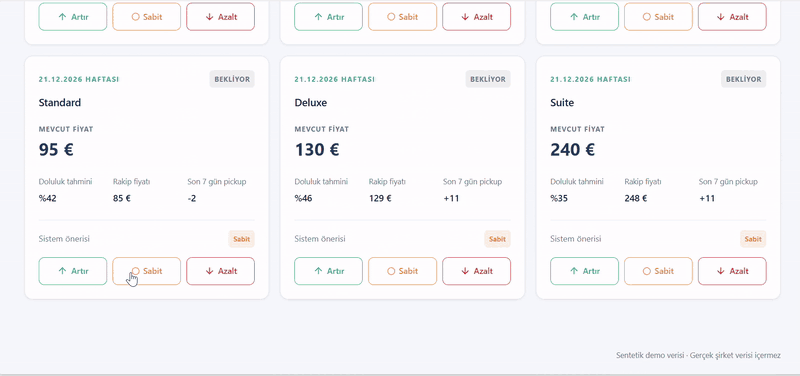
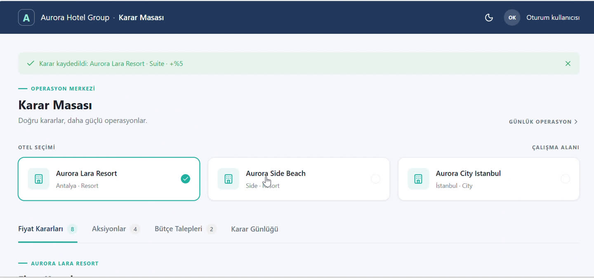
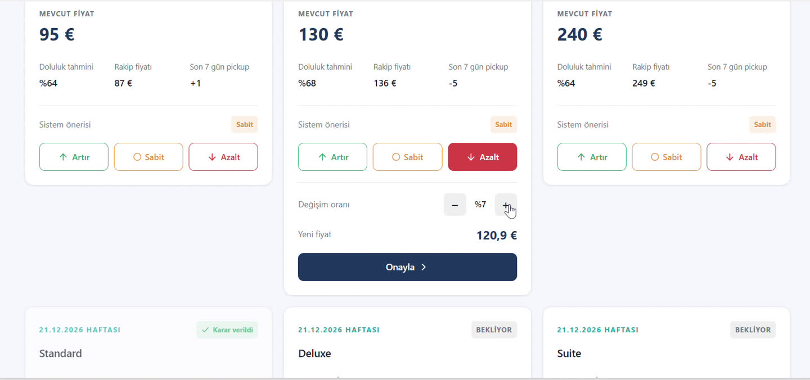
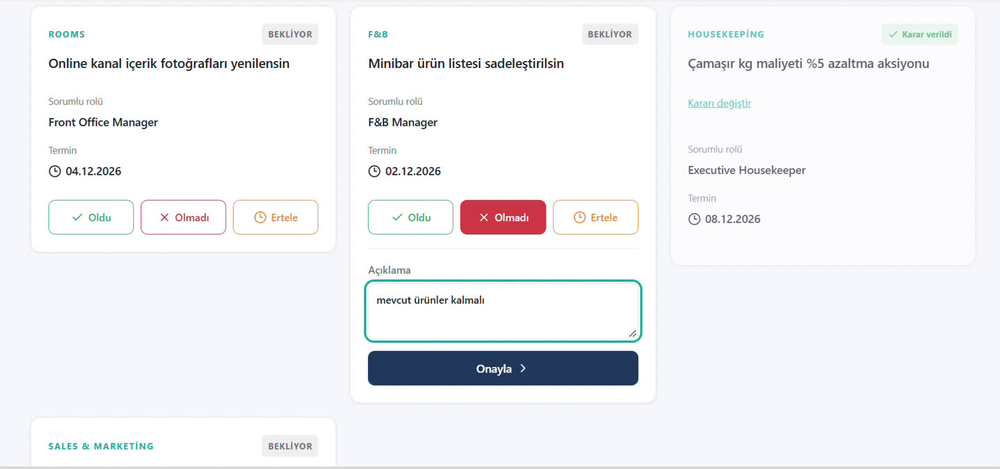
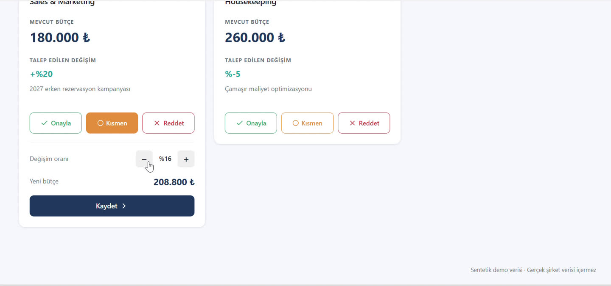
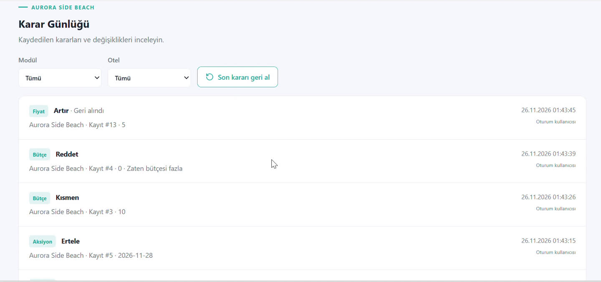

# Karar Masası · Hotel Decision Desk (Microsoft Fabric data app)

> **All data is synthetic. No company data is used.**
> "Aurora Hotel Group", its hotels, people and figures are fictional.

## The problem

In hotel operations, many decisions still live in e-mail threads, chat groups and spreadsheets:
*Should we raise this rate? Was this action done? Do we approve this budget request?*
The numbers are in the report, but the decision is made somewhere else and is hard to trace later.

## What the app does

Karar Masası (Decision Desk) puts these decisions on one screen, next to the data.

| Module | Decision buttons | Rules |
|---|---|---|
| **Pricing** | Raise / Hold / Lower | Shows occupancy forecast, competitor rate and 7-day pickup; the new rate is calculated live (1–15% steps) |
| **Actions** | Done / Not done / Postpone | "Not done" requires a note, "Postpone" requires a new date |
| **Budget requests** | Approve / Partial / Reject | Partial approval with an adjustable %, rejection requires a reason |
| **Decision log** | Undo last decision | Every decision is stored with a timestamp; filter by module and hotel |

## Why it matters

Connected to live PMS and budget data, the same setup lets teams act on the current situation.
For example, when pickup runs ahead of forecast, an ADR increase can be seen and decided in one click,
right where the numbers are read. The gap between reading a report and taking action gets shorter,
without building a separate Power Apps solution.

## How it is built

- **Microsoft Fabric data apps** (Fabric Apps), deployed to a Fabric workspace
- Source data: a synthetic Excel workbook (hotels, rate decisions, action items, budget requests)
- Decisions are written to the app's own database in Fabric, not back to the source file
- Turkish UI, responsive layout (desktop / tablet / mobile)

## Screenshots

| | |
|---|---|
|  |  |
| Hotel selection and pending decision counts | Lower by 7%: new rate calculated live |
|  |  |
| "Not done" requires a note | Partial budget approval |
|  | |
| Decision log with undo | |

## Status

Prototype / portfolio demo. Not production-ready: concurrent edits and server-side undo windows are not handled,
and decisions are logged as "session user".

## Author

**Utku Gökbaraz** · BI Specialist
[utkugokbaraz.com](https://utkugokbaraz.com) · [LinkedIn](https://www.linkedin.com/in/utkugokbaraz)
